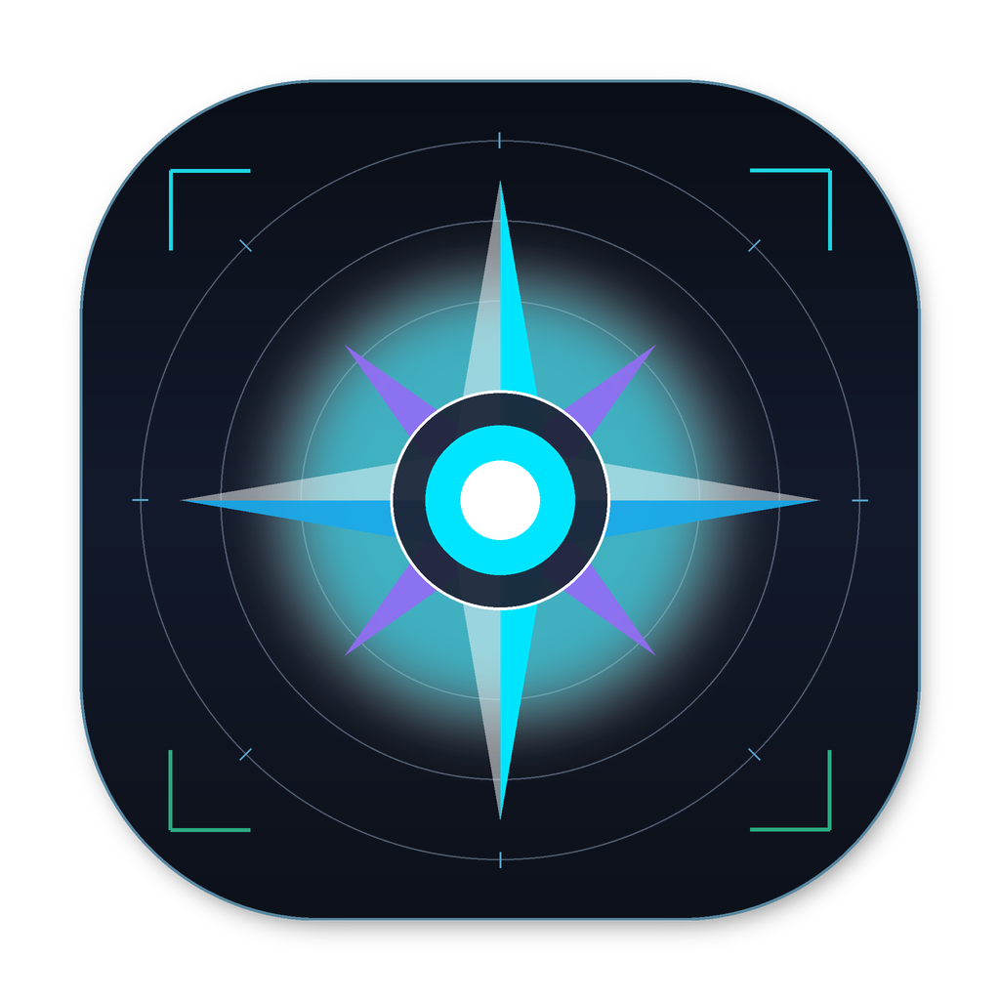

<div align="center">
  
  <h1>NovaVision</h1>
  <p><strong>Windows 便携视觉训练工具</strong></p>
  <p>从数据标注、图像增强到模型训练、导出与推理，连接完整视觉工作流。</p>
  <p>
    
    
    
    
    
  </p>
  <p>
    <a href="https://github.com/Cevlan258/NovaVision-Training-Tool/releases/latest"><strong>下载便携版</strong></a> ·
    <a href="#三步开始使用">快速开始</a> ·
    <a href="NovaVision_用户操作手册.md">完整操作手册</a> ·
    <a href="https://github.com/Cevlan258/NovaVision-Training-Tool/issues">问题反馈</a>
  </p>
</div>

---

## 项目概览

NovaVision 将数据集管理、辅助标注、离线增强、YOLO 训练与模型推理集中在 Windows 桌面界面中。本仓库提供现有 Python 桥接源码、YOLOv5 兼容源码、.NET 性能扩展，以及附带主程序和运行环境的便携发行包。

便携包使用已核验的**本地免激活版本**：正常启动及统一功能入口不依赖授权码、机器绑定或授权文件。启动入口会按解压位置配置路径，无需安装 Python、.NET 或开发 SDK，也无需手动校验文件。

> **下载提示：** 请从 [Releases](https://github.com/Cevlan258/NovaVision-Training-Tool/releases/latest) 下载全部六个 `partNN.zip`。GitHub 自动生成的 **Source code (zip)** 是源码包，不包含完整训练环境。

## 功能一览

| 模块 | 可以完成的工作 |
| :--- | :--- |
| 🏷️ 数据集与标注 | 管理图片和类别，进行检测框、多边形、旋转框、关键点及分类标注 |
| ✨ 图像增强 | 通过旋转、翻转及光照等离线增强扩充训练样本 |
| 🎯 模型训练 | 配置模型、数据集、轮次和设备，通过 Python 桥接执行训练；保留断点续训入口 |
| 📊 评估与预测 | 评估模型表现，使用 PT 模型预测图片及视频 |
| 📦 模型导出 | 提供 ONNX 等导出入口；特殊格式需准备对应后端依赖 |
| ⚡ ONNX 推理 | 使用主程序现有 ONNXRuntime / DirectML 推理入口 |
| 🧩 性能扩展 | 图片列表虚拟化、异步解码与增强、搜索防抖及增量保存优化 |

界面与脚本覆盖 **Detect / Segment / OBB / Pose / Classify** 五种任务。不同模型和导出后端的依赖与支持范围请以 [操作手册](NovaVision_用户操作手册.md) 及实际运行结果为准。

## 三步开始使用

### 1. 下载全部六个附件

在 [最新发行版](https://github.com/Cevlan258/NovaVision-Training-Tool/releases/latest) 下载下表全部文件，总下载量约 **6.41 GiB**。

| 附件 | 大小 | 下载 |
| :--- | ---: | :---: |
| `NovaVision-Windows-x64-part01.zip` | 1,604.28 MiB | [part01](https://github.com/Cevlan258/NovaVision-Training-Tool/releases/download/v2026.10.07/NovaVision-Windows-x64-part01.zip) |
| `NovaVision-Windows-x64-part02.zip` | 1,324.23 MiB | [part02](https://github.com/Cevlan258/NovaVision-Training-Tool/releases/download/v2026.10.07/NovaVision-Windows-x64-part02.zip) |
| `NovaVision-Windows-x64-part03.zip` | 561.92 MiB | [part03](https://github.com/Cevlan258/NovaVision-Training-Tool/releases/download/v2026.10.07/NovaVision-Windows-x64-part03.zip) |
| `NovaVision-Windows-x64-part04.zip` | 1,177.42 MiB | [part04](https://github.com/Cevlan258/NovaVision-Training-Tool/releases/download/v2026.10.07/NovaVision-Windows-x64-part04.zip) |
| `NovaVision-Windows-x64-part05.zip` | 969.03 MiB | [part05](https://github.com/Cevlan258/NovaVision-Training-Tool/releases/download/v2026.10.07/NovaVision-Windows-x64-part05.zip) |
| `NovaVision-Windows-x64-part06.zip` | 923.45 MiB | [part06](https://github.com/Cevlan258/NovaVision-Training-Tool/releases/download/v2026.10.07/NovaVision-Windows-x64-part06.zip) |

这些是**独立 ZIP**，无需拼接，也不需要额外解压软件。GitHub Releases 单个附件必须小于 2 GiB，因此完整环境采用多个附件分发。[GitHub 官方说明](https://docs.github.com/en/repositories/releasing-projects-on-github/about-releases)

### 2. 解压到同一个目录

对每个 ZIP 选择**同一个解压目标目录**。六个包均包含顶层 `NovaVision/`，合并后占用约 **9.12 GiB**，文件互不重复。

```text
你选择的解压目录/
└─ NovaVision/
   ├─ Start_NovaVision.cmd    ← 双击这里
   ├─ portable_launch.py
   ├─ python.exe
   ├─ Lib/
   ├─ DLLs/
   ├─ dotnet/
   └─ App_NovaVision/
      ├─ NovaVision.exe
      ├─ models/
      └─ ViTooAI_Bridge/
```

### 3. 双击启动并选择数据集

双击 `NovaVision/Start_NovaVision.cmd`，在界面中选择数据集、模型、计算设备和输出位置。后续移动目录时仍使用此入口，路径会自动更新。

启动不会自动开始训练。用户数据集及历史训练结果不随发行包分发。

## 系统与环境

| 项目 | 发行包内容或要求 |
| :--- | :--- |
| 操作系统 | Windows 10 / 11，x64 |
| Python | 包内 Python 3.12 与现有第三方依赖 |
| 深度学习 | PyTorch `2.7.1+cu128`、torchvision `0.22.1+cu128` |
| YOLO 框架 | Ultralytics `8.4.152`，另附 YOLOv5 兼容源码 |
| 桌面运行库 | 包内 .NET `9.0.20` Core / WindowsDesktop |
| GPU 训练 | 支持 CUDA 12.8 的 NVIDIA 显卡与兼容驱动 |
| CPU 使用 | 可在支持的任务入口选择 CPU；耗时取决于模型和数据规模 |
| 磁盘空间 | 解压后约 9.12 GiB，另为数据集和训练结果预留空间 |

包内不安装或修改显卡驱动。已有预训练模型可以离线选择；未附带的模型、特殊导出后端或额外资源仍需单独准备。

## 文档导航

| 文档 | 内容 |
| :--- | :--- |
| [用户操作手册](NovaVision_用户操作手册.md) | 数据集组织、标注、增强、训练、导出及推理操作 |
| [便携版说明](PORTABLE_README.md) | 下载、解压、启动方式及环境要求 |
| [性能扩展说明](performance/README.md) | 扩展实现、构建、安装、恢复与验证边界 |
| [发行验证记录](docs/release-verification.md) | 本次便携环境和免激活入口的实际核验结果 |
| [发布维护说明](docs/releasing.md) | 从本地完整运行环境生成 GitHub Releases 附件 |

## 源码目录

```text
App_NovaVision/
├─ ViTooAI_Bridge/       Python 桥接的唯一实现
└─ yolov5/              YOLOv5 兼容源码与上游许可证
ViTooAI_Bridge/          兼容旧路径的轻量入口
performance/            C# 扩展、构建/恢复工具与回归测试
docs/                   发行与验证说明
portable_launch.py      便携路径配置与启动
Start_NovaVision.cmd    Windows 双击入口
pack_portable.py        整理运行环境并生成发行附件
requirements.txt        常用桥接依赖的本机版本参考
```

现有桌面主程序只有发布二进制，**没有完整 C# 工程源码**。Releases 附带可运行程序；仅克隆仓库无法单独构建完整桌面应用。

<details>
<summary><strong>源码开发：Python 桥接与回归测试</strong></summary>

建议创建独立 Python 3.12 环境：

```powershell
python -m venv .venv
.\.venv\Scripts\python.exe -m pip install -r requirements.txt
.\.venv\Scripts\python.exe ViTooAI_Bridge\bridge_train.py --help
.\.venv\Scripts\python.exe -B -m unittest discover -s performance\tests -v
```

`requirements.txt` 是常用依赖版本参考，不是全部模型/导出后端的完整环境锁文件。GPU 环境需另外选择匹配的 PyTorch/torchvision CUDA 构建；上述安装命令不保证得到发行包的 cu128 组合。YOLOv5 专项依赖见 `App_NovaVision/yolov5/requirements.txt`。

.NET 扩展的 `Build.ps1` 依赖便携 SDK、原程序集备份及本地 Python。仓库不附这些构建资源，准备方式和限制见 [性能扩展说明](performance/README.md)。

</details>

## 发行验证与当前边界

本次发行包已通过 ZIP 完整性、附件合并完整性、关键文件一致性、运行依赖导入、CUDA 前向/反向计算、YOLO26 单张合成图推理、训练命令帮助入口，以及包内 .NET 9 的 WPF 资源和视图模型加载检查。

免激活检查在**包内实际 DLL 与包内 .NET 9.0.20**上执行：状态有效且无到期时间，统一训练/导出/自动标注检查放行，正常入口不读取授权文件或执行机器绑定。历史授权类型仍保留在程序集内，不代表已删除所有加密代码。

尚未执行另一台电脑的 GUI 启动、完整训练或全部模型与导出格式测试。这些检查验证发行环境和指定入口，不构成模型精度或训练稳定性的全面验收。详细证据范围见 [发行验证记录](docs/release-verification.md)。

## 问题反馈

如遇问题，请在 [Issues](https://github.com/Cevlan258/NovaVision-Training-Tool/issues) 提供系统版本、显卡与驱动、使用的模型/任务、复现步骤和错误日志。请先移除日志中的私人路径、数据和凭据。

## 第三方内容与许可证

YOLOv5 上游采用 **AGPL-3.0**，完整文本保留在 [App_NovaVision/yolov5/LICENSE](App_NovaVision/yolov5/LICENSE)，上游说明和引用文件一并保留。Python、PyTorch、.NET、其他依赖、模型及资源遵循各自的许可条件；便携包保留相关许可证文件。

本仓库未为全部源码和桌面二进制统一授予新的开源许可证。Python 安装包的许可证不是整个项目的许可证。

---

<div align="center">
  <sub>NovaVision · 数据标注 → 图像增强 → 模型训练 → 导出与推理</sub>
</div>
